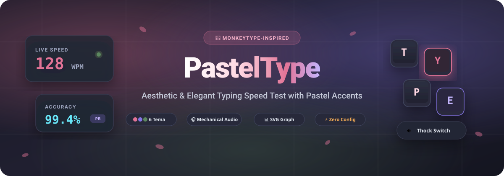

<div align="center">

  

  <br />
  <br />

  <p align="center">
    <a href="https://panduasmara.github.io/PastelType/">
      
    </a>
    <a href="https://github.com/PanduAsmara/PastelType/blob/main/LICENSE">
      
    </a>
    <a href="https://github.com/PanduAsmara/PastelType/stargazers">
      
    </a>
    
  </p>

  <p align="center">
    🎮 <strong>Live Demo:</strong> <a href="https://panduasmara.github.io/PastelType/"><strong>https://panduasmara.github.io/PastelType/</strong></a>
  </p>

  <p align="center">
    <em>Aplikasi tes kecepatan mengetik berbasis web yang dirancang dengan estetika visual pastel yang menenangkan, tipografi elegan, mechanical keyboard procedural audio synthesizer, serta grafik kurva performa interaktif tanpa library eksternal.</em>
  </p>

</div>

---

## 🌸 Tentang PastelType

**PastelType** adalah aplikasi *speed typing test* modern yang terinspirasi dari antarmuka minimalis **Monkeytype**, namun didesain ulang dengan sentuhan **warna-warna pastel yang lembut, hangat, dan ramah di mata**. 

Dibuat menggunakan standar murni web modern (*HTML5, CSS3, ES6+ JavaScript*) tanpa library pihak ketiga (Zero Dependencies), membuat aplikasi ini memiliki waktu muat secepat kilat (*sub-second load*) dan dapat berjalan langsung di peramban apa pun.

---

## ✨ Fitur Utama (Highlights)

### 🎨 6 Palet Tema Warna Pastel Menenangkan
Didesain dengan rasio kontras visual yang seimbang untuk sesi mengetik yang nyaman dan bebas distraksi:

| Tema | Nuansa Warna | Deskripsi |
| :--- | :---: | :--- |
| **🌸 Sakura Blossom** *(Default)* | `#faf5f6` &bull; `#e27396` &bull; `#fdedf1` | Paduan lembut blush pink, rose petal, dan cream hangat |
| **🍵 Matcha Latte** | `#f4f6f2` &bull; `#5c8760` &bull; `#eaf1e8` | Nuansa sage green, linen beige, dan forest slate |
| **☁️ Pastel Lavender** | `#f6f5fc` &bull; `#8675e6` &bull; `#eeebff` | Dreamy periwinkle, soft lilac, dan awan putih |
| **🍑 Peach Gelato** | `#fdf7f2` &bull; `#e67d58` &bull; `#fdede6` | Kehangatan apricot pastel dan golden peach segar |
| **🍋 Lemon Meringue** | `#fdfdf5` &bull; `#c99834` &bull; `#fbf5dc` | Butter yellow lembut dengan sentuhan mint |
| **🌌 Midnight Pastel** | `#1a1b24` &bull; `#a78bfa` &bull; `#67e8f9` | Dark mode aesthetic dengan aksen neon pastel lilac & cyan |

---

### ⚡ Mesin Mengetik Presisi (Monkeytype-Inspired)
* **Smooth Caret Interpolation**: Kursor beranimasi halus meluncur mengikuti huruf secara presisi dengan 4 pilihan gaya kursor (`Smooth Bar`, `Soft Block`, `Underline`, `Outline`).
* **Multi-line Fluid Auto Scroll**: Teks otomatis bergeser ke atas secara anggun ketika berpindah baris sehingga pandangan mata tetap fokus di tengah layar.
* **Deteksi Error & Karakter Ekstra**:
  * Huruf benar: kontras elegan sesuai tema aktif.
  * Huruf salah: ditandai dengan garis bawah bergelombang pastel merah.
  * Karakter ekstra: ditampilkan secara visual jika mengetik huruf berlebih dari panjang kata target.
  * Dukungan <kbd>Backspace</kbd> dan <kbd>Ctrl</kbd> + <kbd>Backspace</kbd> (hapus kata instan).

---

### 🎯 Ragam Mode & Bahasa Lengkap
* **⏱️ Waktu (Time Mode)**: Pilihan durasi `15s`, `30s`, `60s`, `120s`.
* **📝 Kata (Word Mode)**: Pilihan jumlah kata `10`, `25`, `50`, `100`.
* **💬 Kutipan (Quote Mode)**: Kutipan inspiratif bermakna dari tokoh Indonesia (*Pramoedya Ananta Toer, B.J. Habibie, Ki Hajar Dewantara, Soekarno*) dan tokoh dunia (*Steve Jobs, Albert Einstein, Marcus Aurelius*).
* **🧘 Mode Zen**: Sesi mengetik bebas tanpa batas waktu untuk melatih ketenangan dan ritme jari.
* **🔣 Toggle Tanda Baca & Angka**: Latihan tanda baca kompleks (`@ # ! ? , . "`) dan angka numerik acak.
* **🌐 Pilihan Bahasa**:
  * 🇮🇩 **Bahasa Indonesia** (Koleksi ratusan kosakata umum, baku, dan variatif)
  * 🇬🇧 **English** (Top common typing test vocabulary)
  * 💻 **Code / Pemrograman** (Sintaks JavaScript/HTML/CSS untuk melatih refleks programmer)

---

### 🔊 Procedural Mechanical Switch Synthesizer
Dibangun langsung menggunakan **Web Audio API** bawaan peramban — **100% tanpa file audio eksternal**, bekerja secara instan tanpa latensi:
* **Cream / Lubed Switch**: Karakteristik suara *thock* yang halus, empuk, dan teredam.
* **Deep Thock**: Suara hentakan padat ala custom mechanical keyboard.
* **Blue Switch**: *Clicky* renyah ganda dengan pegas taktil.
* **Bubble Pop 🫧**: Efek gelembung air pastel yang imut dan menyenangkan.
* **Mesin Tik Antik**: Sensasi retro mechanical strike.
* **Mute**: Mode hening untuk fokus penuh.

---

### 📊 Dashboard Analitik & Personal Best (PB)
* **Metrik Komprehensif**: WPM (Words Per Minute), Akurasi (%), Raw WPM, Konsistensi (%), dan Waktu Tempuh.
* **Grafik Kurva Kecepatan SVG**: Visualisasi kurva laju WPM dan Raw WPM detik demi detik lengkap dengan titik indikator kesalahan.
* **Personal Best & Confetti**: Deteksi rekor terbaik otomatis disertai selebrasi pesta konfeti pastel 🎉.
* **Penyimpanan Lokal (LocalStorage)**: Seluruh riwayat tes tersimpan rapi di browser tanpa perlu registrasi akun.
* **Bagikan Hasil**: Salin kartu hasil ke clipboard dalam satu klik.

---

## 🚀 Cara Menjalankan

### Opsi 1: Buka Live Demo (Paling Mudah)
Langsung buka tautan berikut di browser:
👉 **[https://panduasmara.github.io/PastelType/](https://panduasmara.github.io/PastelType/)**

### Opsi 2: Buka Langsung Secara Lokal (Tanpa Instalasi)
1. Clone repositori:
   ```bash
   git clone https://github.com/PanduAsmara/PastelType.git
   ```
2. Buka folder proyek dan klik dua kali berkas `index.html` (atau `start.bat` untuk Windows).
3. Selesai! PastelType langsung berjalan di browser Anda.

### Opsi 3: Menggunakan Local Development Server
```bash
# Menggunakan Python
python -m http.server 8080

# Atau menggunakan npx / Node
npx serve .
```
Lalu buka `http://localhost:8080` di browser.

---

## ⌨️ Pintasan Keyboard (Shortcuts)

| Pintasan | Aksi |
| :--- | :--- |
| <kbd>Tab</kbd> | Mengulang tes secara instan dengan bank kata baru |
| <kbd>Esc</kbd> | Reset tes / Batalkan fokus |
| <kbd>Ctrl</kbd> + <kbd>Backspace</kbd> | Menghapus seluruh kata yang sedang aktif |
| <kbd>Backspace</kbd> | Menghapus satu karakter sebelumnya |

---

## 📁 Struktur Berkas

```
PastelType/
├── index.html        # Halaman utama aplikasi, modal, dan struktur tampilan
├── README.md         # Dokumentasi lengkap proyek & showcase
├── LICENSE           # Lisensi Open Source (MIT)
├── start.bat         # Launcher praktis untuk Windows
├── assets/
│   └── banner.svg    # Banner vektor resolusi tinggi PastelType
├── css/
│   └── style.css     # Sistem desain tema pastel, layout, dan animasi caret
└── js/
    ├── app.js        # Controller aplikasi & event handling
    ├── audio.js      # Web Audio API procedural synthesizer
    ├── bundle.js     # Script terintegrasi mandiri (support file:// & http://)
    ├── chart.js      # Generator grafik kurva performa SVG interaktif
    ├── confetti.js   # Efek konfeti selebrasi rekor pribadi
    ├── storage.js    # Pengelola LocalStorage riwayat & preferensi
    └── words.js      # Database kosakata Indonesia, Inggris, Kode, & Quotes
```

---

## 📄 Lisensi

Proyek ini dilisensikan di bawah lisensi open-source [MIT License](LICENSE). Bebas digunakan, dimodifikasi, dan didistribusikan.

---

<div align="center">
  Dibuat dengan dedikasi dan cinta untuk komunitas mengetik cepat &bull; Dikembangkan oleh <a href="https://github.com/PanduAsmara">Pandu Asmara</a> 🌸
</div>
